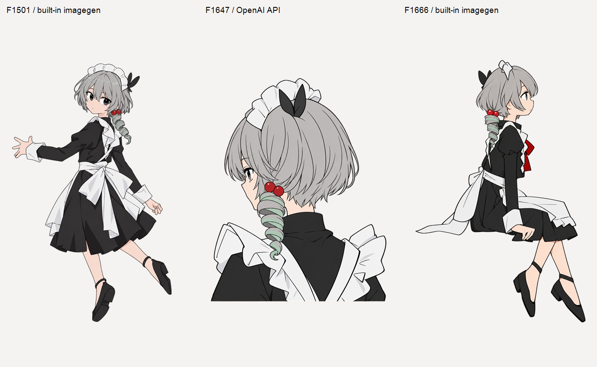

# 魔术之心 · PV 人物重绘

## 2026-11-05 交接入口

[最新人工评审与全片修复要求](deliverables/handoff_20261105/HANDOFF.md#人工评审后的续作要求) 已随交接保存。全片主基线为 ART-G13-02。G35-01 修复后的画法仅用于 G35 段。绘制目标已暂停。

[打开 307 项人工评审网页](manual_review/index.html)。网页可离线打开，支持原 PV 对照、734 个内容去重版本、逐项状态和意见，以及全量 JSON 导出。人工记录保存在浏览器本机，初始全部待评。详细交接见 [HANDOFF.md](deliverables/handoff_20261105/HANDOFF.md)。

本轮 41 张缺失首稿已使用 OpenAI API Image 2.6 Sunburst high 全部返回并保存。当前登记含待修和待审稿，全部制作与验收仍有后续工作。最新要求包括横向并排双红珠、远侧自然遮珠，以及两大卷后独立小灰卷再接短 C。G33-16 的露珠与连接被用户指出需要修复。眼色局部处理和肤色统一分别按已记录流程继续。

以下段落保留此前阶段说明，版本与要求以本次交接和当前登记为准。

## 历史阶段记录

F1058、F1071 已按最新复看重绘钻发，完成新主审、Sol xhigh 静态复核及对应8曝光重新定位绑定。首段 F834–1133 当前66稿静态候选、300曝光绑定及渲染回读；[新版审阅页](art/20261102_first_dance_66states_review_v02/index.html)、[相邻五稿与原PV对照](art/20261102_dance_curl_updown_current_v05/curl_updown_original_current_detail.png)、[四分之一速度对照](art/20261102_dance_curl_updown_current_v05/F1053-F1074_original_vs_current_quarter_speed.mp4)。实际连续播放检查、相邻稿动态平顺及用户艺术验收仍待完成，全片GOAL未完成。

[v01 审阅页](art/20261102_first_dance_66states_review_v01/index.html)、用户否决稿和各轮失败返图完整保留为历史；旧状态见[修复交接记录](art/full_character_redraw_1080p_v01/review/firstdance_bounce55_58_repair_delivery_20261102_v02/DELIVERY_REGISTRATION.json)。

当前 **全片人物绘制 GOAL 正在执行**：核清原 PV 全部 4763 帧的可见绘制态，完成初始 307 项及后续发现的新绘制项、API high 绘制、自评、Sol xhigh 独立复核和曝光连续性检查。当前逐稿版本以 [ASSET_REGISTRY.json](art/full_character_redraw_1080p_v01/ASSET_REGISTRY.json) 为准，状态与调用统计见 [PROGRESS.json](art/full_character_redraw_1080p_v01/PROGRESS.json)。全片尚未完成。

**最新眼睛参考改为用户偏好的 G02-01/v01（F100）**，后续试单色深灰虹膜与小白高光，各帧的睁眼程度、表情及视线仍按当前原 PV，不能把半闭眼套给所有动作。该图的小钻发已被用户指出不合适；发量使用最初人物设定的完整正／侧钻发参考，保留自然遮挡。F858 为此前眼睛基准。默认规则见 [image_defaults.json](image_defaults.json)。

[F100 单色眼与完整钻发的新整稿](art/full_character_redraw_1080p_v01/drawings/ART-G02-01/v02/whole_imggen_v01/qa_white.png)已依次完成 API 整体试绘、API 局修、内置 imggen 整体重绘和 [Sol xhigh 独立复核](art/full_character_redraw_1080p_v01/review/sol_xhigh_G02_whole_final_v06.md)，目前为静态候选。任何局修或拼接后的稿件都须经过 imggen 整体重绘与重新审核。内置工具不公开模型及质量参数，工程记录与 API `high` 分开。

以下保留上一轮三帧返修的历史交付入口。F1647 旧整稿在转身回归中发现比原片过早露出侧眼，已撤回候选；[F1647 新整稿 v04](art/full_character_redraw_1080p_v01/drawings/ART-G21-01/v04/qa_white.png) 已从源帧恢复遮眼视向并通过主审与 Sol xhigh 静态复核。当前版本和状态以逐稿注册表为准：

| 帧 | 透明生成原图 | 1080P 人物层 | 定位预览 |
|---|---|---|---|
| F1501 | [imagegen v02](art/full_character_redraw_1080p_v01/whole_character_restart_v01/delivery/F1501_character_original.png) | [RGBA](art/full_character_redraw_1080p_v01/whole_character_restart_v01/delivery/F1501_character_1920x1080.png) | [预览](art/full_character_redraw_1080p_v01/whole_character_restart_v01/delivery/F1501_1080P_position.png) |
| F1647（历史，已撤回） | [API high](art/full_character_redraw_1080p_v01/whole_character_restart_v01/delivery/F1647_character_original.png) | [历史 RGBA](art/full_character_redraw_1080p_v01/whole_character_restart_v01/delivery/F1647_character_1920x1080.png) | [历史预览](art/full_character_redraw_1080p_v01/whole_character_restart_v01/delivery/F1647_1080P_position.png) |
| F1666 | [imagegen](art/full_character_redraw_1080p_v01/whole_character_restart_v01/delivery/F1666_character_original.png) | [RGBA](art/full_character_redraw_1080p_v01/whole_character_restart_v01/delivery/F1666_character_1920x1080.png) | [预览](art/full_character_redraw_1080p_v01/whole_character_restart_v01/delivery/F1666_1080P_position.png) |

三张均为一次生成的完整人物，交付原图保持生成文件字节；1080P 人物层仅对整个人物统一缩放、平移。原片字幕、特效、背景及独立道具留待后期合成；粉色定位图用于查看人物位置，不是完整 PV 合成成片。

上一轮三张曾由 **Sol xhigh** 独立静态复查。F1501 v02 已恢复背身回望时较睁开的眼神，F1501/F1666 仍为静态候选；F1647 随后因源角度与遮眼不符撤回，这项新回归结论优先于[此前独立复核记录](art/full_character_redraw_1080p_v01/review/sol_xhigh_whole_redraw_v03.md)。相邻曝光连续性及最终场景注册尚未验收。

初始工作计划共 307 项，其中主要人物工作 306 项、附加肖像 1 项；初始有 1929 个未归属曝光帧。核查过程中逐项保存原片绑定证据，剩余数量以进度文件为准。个别返修完成不代表全片完成，当前未记录用户对新稿的艺术验收。

先前被否决的拼头、头饰补丁和旧候选保留为历史。最新文件入口见 [CURRENT_SELECTION.json](CURRENT_SELECTION.json)，当前静态候选的 1080P 暂存人物层见[暂存导出索引](art/full_character_redraw_1080p_v01/delivery_1080p_v01/INDEX.json)，其中定位仍须逐镜核查。本次更新前的工程入口保存在 `art/full_character_redraw_1080p_v01/whole_character_restart_v01/previous_project_entry_20261031/`。

原 PV 及分段工程位于 `D:\CODEX\手书素材\github_moshuzhixin_handoff\magic_maid_20261029`，属于附件 1；附件 2 仅用于拆解参考。

