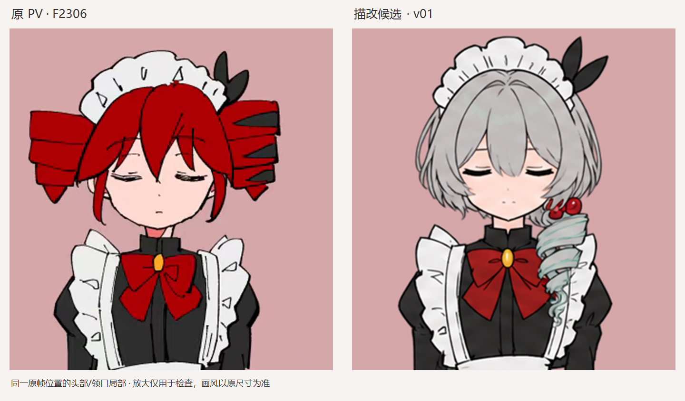
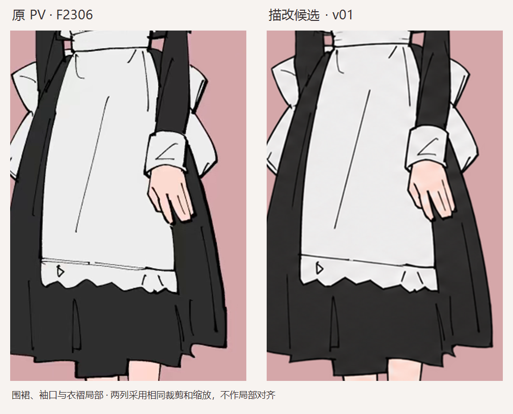

# F2306 描改试稿 v01 · 画风一致性评估

**结论：造型融合与动作匹配基本成立；按“严格匹配原 PV 简笔描线和平涂”的标准，本试稿暂未通过画风一致性评估。** 当前最明显的问题集中在头发、五官和上色方式。建议先修正这些项目，再考虑相邻稿或扩大制作。

这是助手对一张静态试稿的评估，用户尚未验收本稿。没有执行新的付费绘画请求，也没有检验动画连续性。

## 依据与查看方法

- 主参照：附件1原片 F2306 / 01:16.944，M19 / G33-01，1920×1080；另参考过 F3214 的原片上半身画法，以及邻近全身画面。
- 人物身份：本项目的灰发女仆三视图 v01。用户已授权以它试绘一帧；本评估不将三视图的精修画法视作 PV 的画风标准。
- 试稿：API 原始返回为 2048×1152、transparent；以一次等比双三次缩放到1920×1080后，合回原帧。除尺寸适配与透明合成，没有后期补画或姿态变形。
- 看过原尺寸合成全图、透明人物查看图，以及同一区域、相同倍率的头部和衣身对照。放大用于定位差异，不把原视频编码、缩放锯齿都当成笔刷特征。

## 分项判断

| 项目 | 判断 | 可观察证据与影响 |
|---|---|---|
| 新人物身份 | 基本到位 | 灰色短 bob、角色左侧薄荷条纹侧卷发和双红珠保留，正面方向正确。发型轮廓变化属于换人设设计，本项评估其表现方式，不要求恢复原角色的双红卷。 |
| 姿态与服装结构 | 基本接近 | 保留闭眼、双臂垂下、可见手的位置和交叠脚位；黑裙、白围裙、袖口、侧腰结沿用原帧构造。头部体量和部分轮廓仍有偏移，尚非严格逐线登记。 |
| 衣身描线 | 部分接近 | 外轮廓、围裙长褶、袖口与手指线数量总体接近；返图的边缘更规整，个别衣褶重新组织。现有证据不支持宣称与原笔刷一致。 |
| 发束与头饰线 | 明显偏离 | 原片以少量大形状和经济的内部线组织头发、头饰；候选 bob 的发梢、内部发丝和帽褶更细密、连贯、均匀，产生精修设定稿的感觉。侧卷发还出现了较强的体积塑造。 |
| 五官简化 | 偏离 | 闭眼与安静表情保留，但候选的睫毛更厚、更装饰化，鼻口符号和脸部晕染更细致。原片闭眼主要由少量线条交代，肤色更直接。 |
| 平涂与高光 | 头部偏离、衣身部分接近 | 候选头发有柔和明暗/亮带，脸和腿有肤色变化，红领结与金色胸针也增加体积高光。围裙与黑衣的大色块较接近，但仍有轻微明暗起伏。 |
| 整体细节密度 | 偏离 | 精细的脸、bob 内线、帽褶、卷发塑形与较简练的原片衣身放在一起，头部与身体的描绘密度不统一。只添加噪点或毛边不能解决这个问题。 |

## 数值取样提供的有限支持

取样位置、选色规则、像素数与原图哈希见 `STYLE_MEASUREMENTS.json`。以下为同一原尺寸内区取样的灰度亮度 P90−P10，量程0–255；它描述颜色起伏，不是自动画风评分。

| 内区 | 原片 | 候选 |
|---|---:|---:|
| 白围裙 | 0.00 | 1.79 |
| 黑袖 | 0.00 | 2.07 |
| 小腿肤色 | 0.00 | 4.22 |

这些差异本身较小，且候选经过透明合成与一次缩放，不能据此将所有变化都归为绘画渐变。结论主要来自可见的头发分组、五官处理、头饰刻画和明暗方式；取样只支持“候选色块有更多起伏”这一有限观察。

在人物区域内以相对背景的颜色差作边界定位：原帧包围盒 `[790,88,1077,1038)`，候选 `[789,73,1089,1043)`。候选最高点上移约15像素、最低点下移约5像素。此结果用于提醒位置/体量复核，不把不同发型的外形差异当作画风失败的量化证明。

## 合成完整性独立结论

1920×1080 原帧中，人物替换区域为 `[720,48,1190,1060)`；这个区域内用原帧采样的粉色 `(213,167,169)` 清除旧人物底，再叠加候选人物。该区域外的 RGB 变化像素数为 **0**，原字幕得以保留。底色填补是针对已观察到的纯色区域所作的合成处理，不宣称恢复了作者背景工程。

透明层、整帧合成和来源记录已保存，合成技术检查通过。**技术完整性通过与画风验收是两个结论，本稿的画风结论仍是暂未通过。**

## 下次修绘的优先约束

1. 保留 bob、单侧卷发和双红珠的身份特征，将内部发丝归并成较少的大束；发梢避免大量细碎线。帽褶按原片的少量大转折简化。
2. 灰发使用明确的平涂底色与必要的独立色块；薄荷标记保留为清楚的色形。脸、腿和白围裙收回柔和晕染；珠子/胸针采用简单高光符号。
3. 闭眼采用原帧的经济笔道和黑度层级，减少装饰性睫毛与鼻口精修。保持原闭眼表情，不借修风格改变动作。
4. 以原帧衣身为描线基准，优先修正头部的线条密度；再核头饰最高点、下巴、领口、腰线、裙摆和鞋底位置。不要用整体随机粗糙化代替局部画法修正。
5. 修后仍先做同帧对照；一张静态稿通过后，才有依据安排相邻态试验。当前不主张直接按此返图批量生成。

## 文件

- `pv_character_api_raw.png`：API原始返回，2048×1152透明PNG。
- `character_F002306_1920x1080.png`：用于合成的透明人物层。
- `pv_F002306_composited.png`：保留原字幕的整帧查看图。
- `comparison_character.png`：原帧/试稿全身并排查看。
- `request_manifest.json`、`result.json`、`attempt.json`：输入、参数、响应与调用次数，实际仅一次 API 绘画，模型 `gpt-image-2.5-sunburst`，`quality=high`。
- `COMPOSITING_CHECK.json`、`STYLE_MEASUREMENTS.json`、`STYLE_REVIEW.json`：技术验证、描述性取样和本次评估状态。
