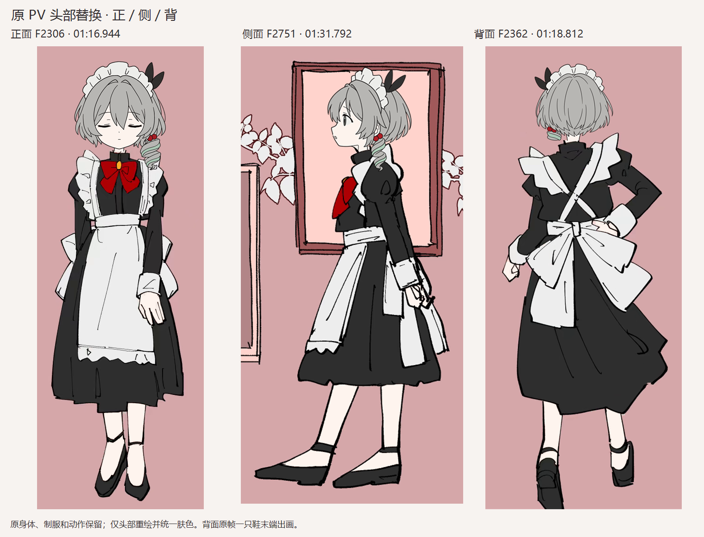
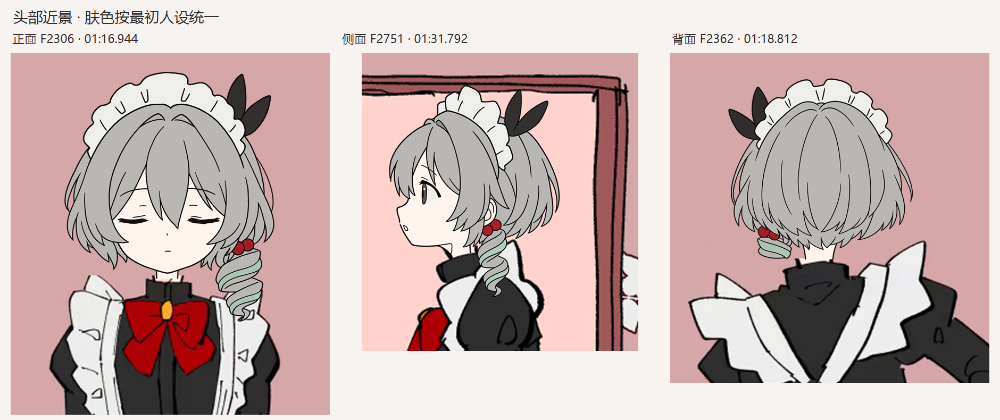

# 正面、侧面、背面：原 PV 换头预览

三张静帧经过整帧与近景核对，已达到我认为可继续使用的预览标准。头部由已配置 OpenAI API 绘制，均为 `high` 质量；随后明确进行有限色板调色、原始人设肤色匹配及分层合成。不是声称 API 原始返回已自行做到完全平涂。

身体、肩宽、制服、手脚动作、字幕和镜头构图沿用附件1原片。只换新角色的头脸与发型，并统一裸露皮肤颜色。没有采用三视图里偏宽的肩膀，也没有把新生成的全身稿作为原 PV 身体。

## 当前文件

| 角度 | 原片位置 | 原尺寸整帧 | 4K 查看版 | 近景与对照 |
| --- | --- | --- | --- | --- |
| 正面 | F2306 / 01:16.944 | [1920×1080](front/composite_1920x1080.png) | [3840×2160](front/composite_3840x2160_view.png) | [头部](front/head_detail.png) / [原片对照](front/source_comparison.png) |
| 侧面 | F2751 / 01:31.792 | [1920×1080](side/composite_1920x1080.png) | [3840×2160](side/composite_3840x2160_view.png) | [头部](side/head_detail.png) / [原片对照](side/source_comparison.png) |
| 背面 | F2362 / 01:18.812 | [1920×1080](back/composite_1920x1080.png) | [3840×2160](back/composite_3840x2160_view.png) | [头部](back/head_detail.png) / [原片对照](back/source_comparison.png) |

4K 文件用于查看：身体、背景和字幕来自 1080P 原片的等比放大，新头部则直接从 1024×1024 API 原稿合成。没有将 1080P 的合成图整体再放大冒充原生 4K。原分辨率文件也保留。

## 画风与身份检查

- **平涂**：去除了灰发、脸部及红珠的无意渐变和高光，保留 API 实际绘制的线稿；未重建头部几何。调色不改变原始 alpha，也不改变深墨线芯。头部采用大色块、少量内线，避免细发丝和立绘式明暗。
- **肤色**：以最初校服人设图的下半脸内区 `[474,224,513,236)` 取样，中位色为 `RGB 254,244,238`。脸、颈部以及原 PV 裸露的手腿统一为这套浅暖白肤色。保留轮廓与抗锯齿；源视频压缩和半透明边缘会使局部出现少量色差。
- **正面**：保留 F2306 的闭眼、小嘴、站姿与手脚位置。修正了生成头部封闭颈底线在领口前造成的衔接问题；领口与身体沿用原片。短灰 bob、人物自身左侧的一束薄荷卷发和双红珠保留。
- **侧面**：独立绘制原帧对应的向画面左方侧脸，保留一只睁眼与小张口。不是镜像或旋转正面脸。收紧了颈部调色多边形，消除浅色画框被误调成肤色的局部；补齐了前脚的调色范围。
- **背面**：独立绘制后脑、发梢和短后颈；配件位于画面左侧，只露卷发根部的一小段，长卷发朝人物前方而被遮挡，没有画成长条垂在后背。保留原片交叉围裙带、蝴蝶结与动作。一只鞋末端在该原帧中出画，按原片裁切保留。
- **背景**：正背面旧头部所在处用同帧可见的纯粉底补齐。侧面原红发遮住的画框，使用附件1 F2686 / 01:29.623（G35-01）同位置可见的真实房间背景补回；未生成新画框。可见邻域平均 RGB 差约 0.33～1.58/255，差异包含视频压缩，未对背景做几何变形。

**美术判断**：我对本次三张静帧换头适配结果满意，可作为下一步候选参考。仍能看出新头部墨线比压缩后原片更干净、背面发梢较规整；不宣称逐笔复现原作者画法。用户尚未验收，不据此启动整片批量制作。

## 技术核对与范围

三张原尺寸合成均满足：头部及显式肤色选区之外，意外 RGB 变化为 **0**；头部之外原有深墨线芯变化为 **0**。这说明服装、身体结构和字幕受到保护，技术结果与上面的视觉检查分别记录。

当前只有三个独立角度的静帧。没有制作转身动画，没有验证相邻原画、曝光绑定或动态连续性。

从“分辨率略低，再生成一张”开始共四次实际 API 绘画：

| 返回目录 | 数量 / 质量 / 尺寸 | 当前用途 |
| --- | --- | --- |
| `../20261030_pv_F002306_v02/` | 1 / high / 1536×2304 | 高分辨率全身新稿，用户随后要求沿用原身体，因此未采用其身体；保留原始返回 |
| `../20261030_head_style_front_v03/` | 1 / high / 1024×1024 | 当前正面头部，经过显式平涂及肤色调色 |
| `../20261030_head_style_side_v01/` | 1 / high / 1024×1024 | 当前独立侧面头部 |
| `../20261030_head_style_back_v01/` | 1 / high / 1024×1024 | 当前独立背面头部 |

每次请求的提示词、参考图、实际模型、输入哈希、原始 API 响应、原始 PNG 和调色记录均保留。旧候选及未通过版本没有删除。侧背面请求实际使用的正面参考副本也保留在各自 `inputs/front_style_master.png`，不随之后的调色脚本改动覆盖。

每个角度目录包含透明 `head_layer_1920x1080.png`、`body_and_background_plate.png`、整帧、近景、原片对照、`COMPOSITING_CHECK.json` 与 `ART_REVIEW.json`。三个 `*_layout.json` 记录定位、旧头部清理及身体肤色选区。`GENERATION_LOG.json` 汇总绘画请求，`SHA256SUMS.txt` 记录本次交付文件哈希。
