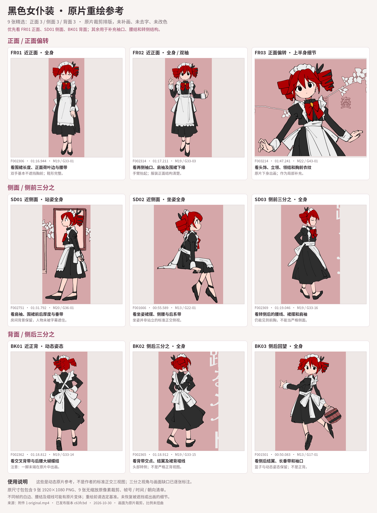

# 黑色女仆装：正面、侧面、背面重绘参考

正面、侧面、背面各 **3 张**，均筛自[附件 1 原片](../../source/original.mp4)，供后续重绘查阅服装结构。**没有重绘、补画、去字、改色或透明抠图**；保留原片背景与字幕。不采用附件 2 作为人物像素来源。

## 选帧与用法

优先看 **FR01 近正面全身、SD01 近侧面站姿、BK01 近正背**。其余帧用于补充袖口、围裙、后背交叉带、腰结和转侧结构。这是动态原片参考，**不是作者的标准正交三视图**。

|编号|朝向与用途|原片帧（从 0 起）|时间|M / G|完整原帧|原像素裁剪|
|---|---|---:|---|---|---|---|
|FR01|近正面 · 全身|2306|01:16.944|M19 / G33-01|[PNG](FR01_F002306.png)|[PNG](FR01_F002306_crop.png)|
|FR02|近正面 · 全身 / 双袖|2314|01:17.211|M19 / G33-03|[PNG](FR02_F002314.png)|[PNG](FR02_F002314_crop.png)|
|FR03|正面偏转 · 上半身细节|3214|01:47.241|M22 / G43-01|[PNG](FR03_F003214.png)|[PNG](FR03_F003214_crop.png)|
|SD01|近侧面 · 站姿全身|2751|01:31.792|M20 / G36-01|[PNG](SD01_F002751.png)|[PNG](SD01_F002751_crop.png)|
|SD02|近侧面 · 坐姿全身|1666|00:55.589|M13 / G22-01|[PNG](SD02_F001666.png)|[PNG](SD02_F001666_crop.png)|
|SD03|侧前三分之 · 全身|2369|01:19.046|M19 / G33-16|[PNG](SD03_F002369.png)|[PNG](SD03_F002369_crop.png)|
|BK01|近正背 · 动态姿态|2362|01:18.812|M19 / G33-14|[PNG](BK01_F002362.png)|[PNG](BK01_F002362_crop.png)|
|BK02|侧后三分之 · 全身|2365|01:18.912|M19 / G33-15|[PNG](BK02_F002365.png)|[PNG](BK02_F002365_crop.png)|
|BK03|侧后回望 · 全身|1501|00:50.083|M13 / G17-01|[PNG](BK03_F001501.png)|[PNG](BK03_F001501_crop.png)|

- 不带 `_crop` 的 9 张 PNG 是 **1920×1080 完整原帧**，没有裁切或缩放。
- 9 张 `_crop.png` 是原像素裁剪，**没有缩放**；裁剪边界采用 `[x0,y0,x1,y1)`，见 JSON / CSV。
- 总览为方便阅读等比缩放排版，生产取样应使用原帧或原像素裁剪。
- [参考帧清单.csv](参考帧清单.csv) 和 [reference_manifest.json](reference_manifest.json) 包含帧号、精确 PTS、方向、用途、限制、M/G 编号、文件路径与哈希。PTS 单位为 **1/16000 秒**，显示时间只取毫秒。

## 明确限制

- **FR03** 原片下身已出画，只作为上半身细节补充。
- **SD02** 是坐姿，不是站立的标准正交侧视；**SD03** 为侧前三分之，仍能看到前胸。
- **BK01 / F2362** 一脚末端在原片中出画；没有生成或补足。
- **BK02** 为侧后三分之、头部转侧；**BK03** 为侧后回望，保留篮子与动态姿态；均不是严格正背。
- 不同帧的白边、腰结和裙线可能存在原片动画变体。后续重绘应先选定统一基准；隐藏或出画部分不能从本包推定完整结构。

## 来源和校验

原片 SHA-256：`ec5e207ae3ef97da5a7866bfcaed3b23216dcc828bc87be72668e66533038cc1`。
来源清单版本：`c63fcbdcaad08972d03daaeed2aff83dc32cdba2`。9 张完整原帧的 RGB 指纹均与已发布逐帧清单一致，9 张裁剪与对应原帧指定区域逐像素相同。

本目录 PNG 字节与本次已交付 Library 参考包一致；为便于网页直接浏览，散图置于同一目录并同步更新清单路径。只新增参考目录，不修改原视频、原有参考、绘制计划或 main 分支。不重复提交相同内容的 ZIP。

在本目录可用 `sha256sum -c SHA256SUMS.txt` 检查 22 个交付文件。
